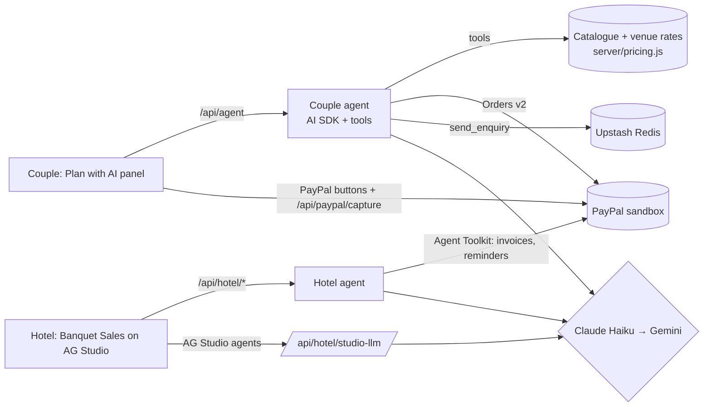

# Wedding Studio: plan a wedding with an AI agent, pay deposits with PayPal

Wedding Studio is a Singapore wedding planner built around a 3D map of the city and a 3D ballroom.
For the **PayPal AI Hackathon** it gained two AI agents that use PayPal:

- **For couples, "Plan with AI".** You give your tables, budget and style. The agent picks a venue and vendors,
  checks the budget (including the ++ of 10% service charge and 9% GST), places everything in the 3D ballroom while
  you watch, and prepares **one PayPal order with a 20% deposit line for each vendor**. Nothing is charged until you
  approve it in PayPal.
- **For venues, the "Banquet Sales" dashboard** (built on **AG Studio**). The couple's enquiry arrives as a qualified
  lead. The hotel's agent drafts the quote, the sales manager approves a **PayPal invoice** for the banquet deposit,
  and the agent writes **friendly reminders** that are sent as PayPal invoice reminders. A Bookings assistant answers
  questions about deposits and asks AG Studio's built-in agents to build charts.

> All venues and vendors are **fictional demo venues and vendors**, placed on real OpenStreetMap buildings.
> Payments use the **PayPal sandbox** (no real money). Started on 31 Oct 2026, during the hackathon's submission period.

## Try it

**Hosted demo:** _(added at deployment)_

| What | How |
| --- | --- |
| Sign in as a couple | Any email (demo sign-in; nothing leaves your browser) |
| Pay deposits in PayPal | Use the PayPal **sandbox buyer** login given in the Devpost testing instructions |
| Venue dashboard | Landing page → **For venues** → Venue sign-in (or `/#venues`), with the demo password given in the Devpost testing instructions |

A two-minute path:
1. **Design** → **Plan with AI** → pick "30 tables, S$95,000 all-in, garden style, near Orchard".
2. Watch the steps. The map flies to The Orchard Grand, and the ballroom opens with 30 tables, greenery
   centrepieces, a floral arch and a fairy-light canopy.
3. **Secure these vendors** → approve the deposits in the PayPal sandbox window.
4. **Send enquiry to the venue** (use your sandbox buyer email so the invoice reaches you).
5. Footer → **For venues (demo)** → **Draft quote with AI** → **Approve and send PayPal invoice**.
6. **Planner** → **Venue deposits** → **Pay with PayPal**. Back on the dashboard it shows **Deposit paid: date secured**.
7. On the dashboard, **Ask the dashboard (AI)** → "Who still owes a deposit?" or "Add a chart of deposits by month".

## How it uses PayPal

| PayPal capability | Where |
| --- | --- |
| **Orders v2** (create in SGD, capture) | The couple's agent creates one order with a deposit line per vendor (`server/paypalApi.js`). The server captures only after the couple's approval, idempotently, and checks the captured amount against that order (`server/capture.js`) |
| **JavaScript SDK buttons** (`@paypal/react-paypal-js`) | The couple approves the agent's order (`src/explorer/agent/PayButton.jsx`) |
| **PayPal Agent Toolkit** (`@paypal/agent-toolkit`, Vercel AI SDK): `create_invoice`, `send_invoice`, `send_invoice_reminder`, `get_invoice`, `list_invoices` | The hotel's agent flow: deposit invoices, friendly reminders and payment status (`server/paypal.js`, `server/hotel.js`) |

The toolkit's `create_order` tool only accepts USD, so the SGD deposit order uses Orders v2 directly.

## How it uses AI

| Tool | How |
| --- | --- |
| **Claude Haiku 5.5** (Anthropic), via the **Vercel AI SDK** | Runs both agents: couple planning with tools, hotel quotes and reminders, and the AG Studio agents' turns |
| **Gemini Flash** (Google AI Studio, free tier; `gemini-flash-latest`, or set `GEMINI_MODEL`) | Automatic fallback when Claude fails before answering (`server/models.js`) |
| **AG Studio Agent Framework** | Our Bookings assistant is the primary agent. It holds the PayPal-deposit tools and delegates widget building to AG's built-in agents. Every model turn goes through `/api/hotel/studio-llm`, so no key is ever in the browser (`src/hotel/studioAgent.js`) |
| **Claude Code** | Used to write much of this code, from the founder's designs and decisions |

**Safety rules, enforced in code rather than in prompts:**
- **Money:** every amount is computed on the server from the catalogue and venue rate card (`server/pricing.js`), never taken from model text.
- **Approval:** a person approves every order, invoice and reminder.
- **Tool scoping:** each agent only has the PayPal tools it needs (the couple's agent cannot invoice).
- **Plan IDs:** they come from the session, not the model.
- **Cost limits:** 5 agent runs per visitor per hour, and repeated requests are answered from a 30-day cache. Runs that touched PayPal are never cached.
- **Fallback:** when the AI is unavailable, the panel offers a clearly labelled recorded example run.

## Architecture



- **Front end:** Vite + React + react-three-fiber (the 3D city and ballroom).
- **Server:** Vercel functions in `api/`, with the logic in `server/`.
- **Storage:** Upstash Redis free tier, with an in-memory store locally.

## Run it yourself

You need Node.js 20+, a PayPal developer account (sandbox), and an Anthropic and/or Google AI Studio key.

```bash
npm install
cp .env.example .env.local   # then fill in your own keys (never commit this file)
npm run dev
```

**Development notes:**
- **Without model keys:** `AGENT_FAKE=1 npm run dev` uses a scripted stand-in model that calls the real tools.
- **The local API:** `npm run dev` serves the `api/` functions too (see `vite.config.js`).
- **The venue dashboard:** it needs `HOTEL_DEMO_PASSWORD`. AG Studio runs as a watermarked trial without a licence key; set `VITE_AG_STUDIO_LICENSE` to your own trial key to remove it.

To deploy, import the repo in Vercel and add the variables from `.env.example` under **Settings → Environment Variables**.

**Tests:**
- **Unit and API tests:** `npm test`.
- **The 3D map speed test:** `npm run test:map`.

## Licences

The code is MIT licensed (see `LICENSE`). Map data © OpenStreetMap contributors under the ODbL, and other data and asset
licences are listed in `DATA_LICENSES.md`. AG Studio is a commercial component used under its free trial.
