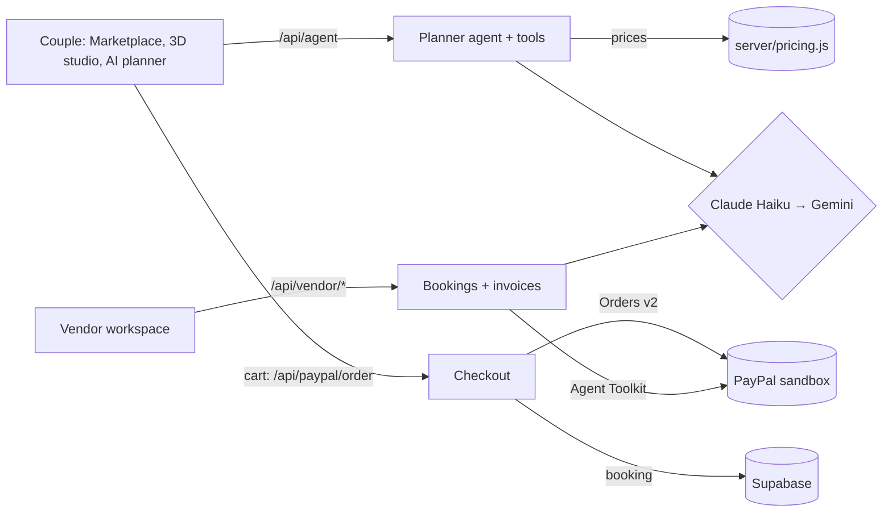

# Wedding Studio

**Plan and book your wedding in one place, and see every vendor's work in your venue in 3D before you pay.**

Wedding Studio is a wedding planning platform. Couples browse vendors, see their florals, music, lighting and
décor placed in an interactive 3D ballroom, ask an AI planner to build a plan within their budget, and pay every
vendor's deposit in one PayPal checkout. Vendors get each booking with a floor plan of where their items go, and
collect the balance with PayPal invoices and AI-written reminders.

Built for the **PayPal AI Hackathon** (started 31 Oct 2026, during the submission period).

> All venues and vendors are fictional demo businesses. Payments use the **PayPal sandbox**: no real money moves.

**Live demo:** https://wedding-studio-gray.vercel.app

## Try it

| What | How |
| --- | --- |
| Couple | Sign in with any email (demo sign-in) |
| Pay | Use a PayPal **sandbox Personal** account (given in the Devpost testing instructions). Demo promo code: `PAYPALDEMO` (10% off deposits) |
| Vendor | **For vendors** → `hello@petalandstem.sg`, password `hackathondemo2026` (other demo vendors are listed on the sign-in page) |

**A five-minute path**
1. **Design** → choose **The Orchard Grand** on the map → the 3D Grand Ballroom opens.
2. **Plan with AI** → "Garden wedding, 16 tables, S$60k". The planner checks venues, vendors and the budget, then
   places every item in the room. Drag anything; switch to **Guest view**.
3. Say **"Secure these vendors"** (or use **Add to Cart** in the Marketplace). The cart opens: change quantities,
   add a promo code, **Make payment**, and approve in PayPal.
4. Back on the site: the planner ticks the tasks you just completed and marks the deposits on your budget.
5. **For vendors** → sign in as Petal & Stem → open the new booking (dates, venue and a floor plan of where the
   flowers go) → **Send balance invoice**. On the **Dashboard**, open a to-do to send an AI-drafted reminder
   with PayPal.

## How it uses PayPal

| PayPal | Where |
| --- | --- |
| **Orders v2**: create (SGD) and capture | One order with a 20% deposit line per vendor, created on the server from the cart (`server/checkout.js`, `server/paypalApi.js`). The couple approves on PayPal's page; the server captures, idempotently, and checks the captured amount, including any promo discount (`server/capture.js`) |
| **PayPal Agent Toolkit**: `create_invoice`, `send_invoice`, `send_invoice_reminder`, `get_invoice` | Vendors invoice the 80% balance, send reminders and see when it's paid (`server/vendor.js`, `server/paypal.js`) |

## How it uses AI

| AI | What it does |
| --- | --- |
| **Couple's planner** (Claude Haiku via the Vercel AI SDK, Gemini Flash fallback) | Uses tools to search venues and vendors, check the budget (including service charge and GST), place the plan in the 3D room, and put the vendors in the cart (`server/agent/coupleTools.js`) |
| **Vendor assistant** | Drafts friendly payment reminders and answers questions about the vendor's bookings and payments (`server/agent/vendorAgent.js`, `src/vendor/insights.js`) |

**Guardrails, in code rather than prompts**
- Every amount is computed on the server (`server/pricing.js`); the browser and the model never set a price.
- A person approves every payment, invoice and reminder.
- Each agent only has the tools it needs; plan IDs come from the session, not the model.
- 5 AI runs per visitor per hour; repeated requests come from a 30-day cache, and payment steps are never cached.

## Tools and technologies

| Area | Tools |
| --- | --- |
| PayPal (sandbox) | Orders v2 REST API (create, capture), PayPal Agent Toolkit (invoices and reminders) |
| AI | Claude Haiku (Anthropic) as the main model, Gemini Flash (Google AI Studio) as the automatic fallback, Vercel AI SDK for tool calling and streaming, Zod for tool schemas |
| Front end | React 18, Vite, three.js, react-three-fiber and drei, lucide-react icons |
| 3D content | Blender and Cycles (ballroom model, baked lighting), OpenStreetMap data for the Singapore city map |
| Server and data | Vercel functions, Supabase (Postgres key-value table) |
| Quality | Node test runner, Playwright (visual and performance checks), ESLint, Prettier |
| Automation | GitHub Actions: tests on every push, map data builds, a daily keep-alive ping |
| Development | Claude Code helped write much of the code, from the founder's designs and decisions |

**Sponsor integrations:** PayPal is the only sponsor integration. We did not use APIMatic, Postman or Render.

## Architecture



- **Front end:** React, Vite and react-three-fiber. The ballroom was modelled in Blender and lit in Cycles, with
  the lighting baked into textures (`scripts/blender/`).
- **Server:** Vercel functions in `api/`, logic in `server/`, storage in Supabase (`docs/supabase.sql`).

## Run it yourself

You need Node.js 20+, a [PayPal developer](https://developer.paypal.com) account (free sandbox), and an Anthropic or
Google AI Studio API key.

1. Install and copy the settings file:
   ```bash
   npm install
   cp .env.example .env.local   # never commit this file
   ```
2. In the PayPal developer dashboard, create a **sandbox** REST app and put its client ID and secret in
   `PAYPAL_CLIENT_ID`, `PAYPAL_CLIENT_SECRET` and `VITE_PAYPAL_CLIENT_ID` (set `PAYPAL_ENV=sandbox`).
3. Add `ANTHROPIC_API_KEY` and/or `GOOGLE_GENERATIVE_AI_API_KEY`.
4. Optional, for shared storage: create a Supabase project, run `docs/supabase.sql` once in its SQL editor, then
   set `SUPABASE_URL` and `SUPABASE_SECRET_KEY`. Without it, data is kept in memory.
5. Start it:
   ```bash
   npm run dev
   ```

- No model keys? `AGENT_FAKE=1 npm run dev` uses a scripted stand-in model that calls the real tools.
- `npm test` runs the unit and API tests; `npm run lint` and `npm run format` check the code style.
- To deploy, import the repo in Vercel and add the same variables in Project Settings → Environment Variables.

## Licences

Code: MIT (see `LICENSE`). Map data © OpenStreetMap contributors (ODbL); other data and asset licences are listed in
`DATA_LICENSES.md`.
